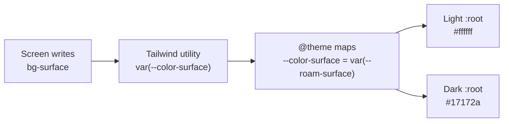
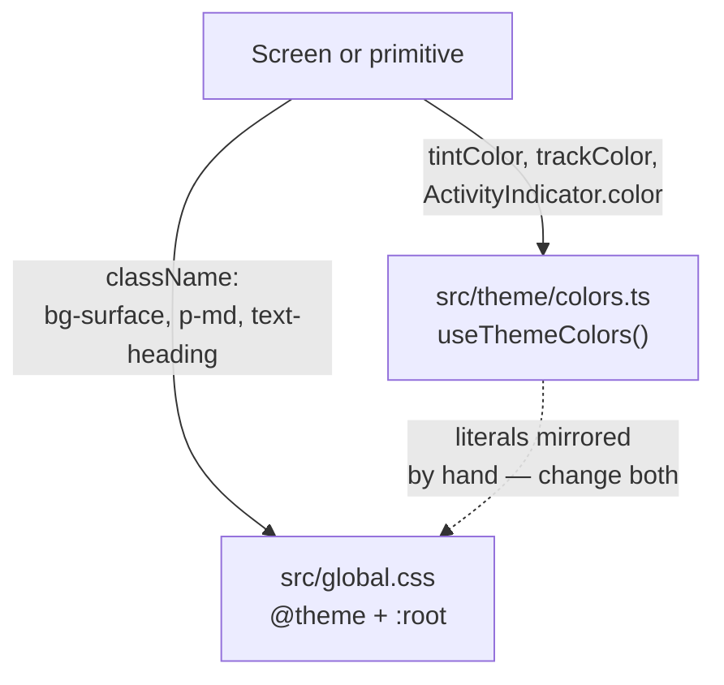

# 04 . Design system

Status: done

> The font and the type ramp were reworked later, in
> `prompts/09-typography-poppins.md`. The rows and tables below that describe
> them are marked where they changed.

## Goal

Every screen draws from one visual source of truth: design tokens derived from
`assets/images/prompt-imgs/prompt-imgs/design.png`, plus a small set of shared
primitives. A screen can be written without ever naming a hex value, a font
size, or a spacing step.

Numbered after `02-system-design` (the app's system design) and
`03-nativewind` (the styling pipeline); the token layer this plan builds on
both.

---

## How a token reaches the screen

Two access paths exist, because React Native has one API that takes a
`className` and several that cannot. The split is the single most important
thing to get right, because the JS side mirrors the CSS by hand.

The dotted edge is the drift risk. There is no build step that keeps
`colors.ts` and `global.css` in agreement, so they are edited together.

---

## Decisions

| # | Decision | Choice | Why |
|---|----------|--------|-----|
| 1 | Where tokens live | Tailwind v4 `@theme` CSS variables in `src/global.css` | The app styles through NativeWind v5, so the styling library's idioms apply. A TS theme object beside NativeWind would be a second, competing system. |
| 2 | How dark mode works | `@theme` maps onto switchable `--roam-*` values overridden by `@media (prefers-color-scheme: dark)` | Light and dark stay **one** token set that flips. The alternative, a `dark:` twin, makes every call site responsible for remembering it. |
| 3 | Font | ~~Platform sans (`nativewind/theme` sets `--font-sans`)~~ **Superseded in `09-typography-poppins`**: Poppins, vendored in `assets/fonts/` and loaded at runtime by `expo-font` | The design specifies Geometric Sans. No font files were bundled when this plan was written; the family was chosen and shipped in plan 09. |
| 4 | Type ramp | Spec's five steps **plus** `title` (18) | The screens show both a page heading (~28) and a card title; the spec's five collapsed them. Confirmed with the user. `title` was 22 here and is 18 since plan 09. |
| 5 | Colors | The 8 palette entries **plus** role and tint tokens | The design uses yellow as a rating color as well as an action color, lavender as a real interactive fill, and lavender-tinted policy cards. Confirmed with the user, who chose all extras. |
| 6 | `on-primary` | Fixed `#0B0B1A` in **both** schemes | The yellow fill stays light enough in dark mode that its label must stay dark. `on-lavender` *does* flip, because lavender lightens. |
| 7 | Shadows | `boxShadow` strings in `src/theme/shadows.ts` | RN 0.76+ prop; the legacy `shadow*`/`elevation` props are never used. Only three levels — the design is mostly flat. |
| 8 | Primitive count | All 14 built now | The skill says wait for two screens; the design sheet is the second user of each. Approved explicitly so screens don't each grow their own. |
| 9 | `Toggle` | Wraps the native `Switch` | The skill says not to wrap platform controls just to route them through the system. This wraps it only to recolor it, keeping the platform's semantics and hit target. |
| 10 | `TabBar` | Controlled (`tabs`/`value`/`onChange`) | Routing belongs to an Expo Router `Tabs` layout; the component should not import the router. |

### Confirmed with the user

| Question | Answer |
|----------|--------|
| Colors beyond the 8 palette entries | Add rating gold, lavender tint + focus, status and tag tints |
| Component scope | Add all 5 missing primitives (`StatusAlert`, `SegmentedControl`, `Toggle`, `Stepper`, `LiquidGlassTabBar`) |
| Type ramp | Add `title` (22) and a `price` emphasis style |
| Dark mode | Light **and** dark pairs now |
| `AGENTS.md` handling | Update the current working copy, don't restore HEAD's |

---

## Token reference

### Color

| Token | Class | Light | Dark | Used for |
|-------|-------|-------|------|----------|
| `primary` | `bg-primary` | `#FFC629` | `#FFC629` | Primary actions, active states |
| `star` | `bg-star` | `#FFC629` | `#FFC629` | Rating star, favourite badges — same yellow, distinct intent |
| `lavender` | `bg-lavender` | `#C984F4` | `#D8A6F8` | AI prompt pill, selected filter, highlights |
| `on-primary` | `text-on-primary` | `#0B0B1A` | `#0B0B1A` | Label on yellow — fixed in both schemes |
| `on-lavender` | `text-on-lavender` | `#FFFFFF` | `#0B0B1A` | Label on lavender — flips |
| `foreground` | `text-foreground` | `#0B0B1A` | `#F5F5F7` | Headings, primary text |
| `muted` | `text-muted` | `#6B7280` | `#9CA3AF` | Body copy, placeholders, secondary labels |
| `surface` | `bg-surface` | `#FFFFFF` | `#17172A` | Cards, sheets, modals |
| `background` | `bg-background` | `#F4F5F7` | `#0B0B1A` | App background, input fields |
| `border` | `border-border` | `#E5E7EB` | `#2A2A3F` | Dividers, borders |
| `lavender-tint` | `bg-lavender-tint` | `#F4E8FD` | `#2A1F3D` | Policy cards, "Roam Explorer" badge |
| `glass` | `bg-glass` | `rgba(255,255,255,0.7)` | `rgba(23,23,42,0.7)` | Tab bar, frosted surfaces |
| `success` | `text-success` | `#0E7A54` | `#3DDC9A` | Success banners, "New" badge |
| `success-tint` | `bg-success-tint` | `#E3F5EC` | `#12312A` | Success banner background |
| `error` | `text-error` | `#D92D20` | `#FF7A70` | Error banners, "20% off" badge |
| `error-tint` | `bg-error-tint` | `#FDECEB` | `#3A1C1C` | Error banner background |
| `star-tint` | `bg-star-tint` | `#FDF1D6` | `#3A2F14` | "Guest favorite" badge |
| `info-tint` | `bg-info-tint` | `#E6EEFB` | `#1A2438` | "Superhost" badge |

> `primary` and `star` share `#FFC629` on purpose. Same value, different
> intent — a rating is not a call to action, and the tokens document that.

### Typography

| Token | Class | Size | Line height | Weight | Used for |
|-------|-------|------|--------------|--------|----------|
| `display` | `text-display` | 60 | 1.0 | bold (700) | Non-stack heroes (onboarding) |
| `hero` | `text-hero` | 32 | 1.05 | extrabold (800) | Onboarding and auth headlines (added in `09`) |
| `heading` | `text-heading` | 28 | 1.2 | bold (700) | Page headings |
| `title` | `text-title` | 18 | 1.2 | bold (700) | Card titles, prices |
| `body` | `text-body` | 16 | 1.5 | regular (400) | Body copy |
| `caption` | `text-caption` | 14 | 1.4 | medium (500) | Supporting labels, chips |
| `button` | `text-button` | 17 | 1.2 | medium (500) | Button labels |
| `field` | `text-field` | 16 | **none** | regular (400) | Single-line `TextInput` only |

> The five steps the design sheet names are `display`, `heading`, `body`,
> `caption` and `button`; `hero` and `title` are the app's two extra steps.
> Sizes, line heights and weights were reconciled with section 03 of the
> design in `prompts/09-typography-poppins.md`, which also moved the family to
> Poppins.
>
> Every line height is a **unitless ratio**. `px` values break the layout,
> because the multiplier is applied against the font size.
>
> `field` intentionally has **no** line height: a line-height on a single-line
> `TextInput` makes iOS wrap the line and clip the field. This was a real bug
> during the build — the input originally used `text-body`.

### Spacing and radius

| Token | Value | Token | Value |
|-------|-------|-------|-------|
| `xs` | 4px | `control` | 12px |
| `sm` | 8px | `card` | 16px |
| `md` | 16px | `full` | 9999px (capsule) |
| `lg` | 24px | | |
| `xl` | 32px | | |
| `xxl` | 48px | | |

Radii were **estimated from the images**: the design's buttons, chips and pills
are capsules, not the 12px first guessed.

---

## Primitives

All live in `src/components/ui/`, take `className` for layout and `style`
merged last, and expose an accessible label that survives loading.

| Component | Variants | Sizes | States |
|-----------|----------|-------|--------|
| `ThemedText` | 6 ramp steps | — | Dynamic Type on |
| `Icon` | — | 16 / 20 / 22 / 24 | decorative, hidden from AT |
| `Button` | `primary`, `secondary`, `ghost` | `sm`, `md`, `lg` | pressed, disabled, loading |
| `IconButton` | — | `sm`, `md`, `lg` | pressed, disabled |
| `InputField` | `search`, `form`, `password` | — | focused, error, reveal |
| `Chip` | `default`, `primary`, `lavender` | `sm`, `md` | selected, pressed |
| `Card` | `surface`, `tinted`, `plain` | — | bordered |
| `Badge` | `favorite`, `new`, `discount`, `superhost`, `accent` | — | — |
| `ProfileRow` | — | — | with/without detail |
| `StatusAlert` | `success`, `error` | — | dismiss |
| `SegmentedControl` | caller-defined | — | selected |
| `Toggle` | — | — | native `Switch` |
| `Stepper` | — | — | clamps at `min`/`max` |
| `TabBar` | — | — | selected, glass available |

`Card` deliberately ships **without** shadows — the design separates surfaces
with hairlines and background contrast, not elevation.

---

## Out of scope

| Item | Belongs to |
|------|-------------|
| Screens (`src/app/index.tsx` is a token smoke test) | the first real feature |
| Font files and `expo-font` loading | ~~after the family is chosen~~ — done in `09-typography-poppins`: Poppins, vendored in `assets/fonts/`, loaded at runtime |
| Clerk, Sanity, routing, `NativeTabs`, `/design-system` route | `02-system-design` |
| Motion primitives (`PressableScale`, `expo-haptics`) | later — pressed feedback is an opacity dip |

---

## Steps

1. **De-risk the styling approach.** Write the `@theme` tokens, add a throwaway
   file using every planned utility, compile with the Tailwind CLI, confirm the
   namespaces generate and the `:root` indirection resolves. Delete the probe.
2. **Token layer** in `src/global.css`: brand colors, surfaces, text, tints,
   glass, spacing, radius, the type ramp with unitless line heights,
   `--text-field` with no line height, and the dark overrides.
3. **JS-only layer**: `src/theme/colors.ts` (light/dark pairs +
   `useThemeColors()`), `src/theme/shadows.ts` (`boxShadow` as `ViewStyle`),
   `src/theme/index.ts`.
4. **Primitives** in `src/components/ui/`, each with variants, sizes,
   pressed/disabled/loading states, `style` merged last, and an accessible label
   that survives loading.
5. **Smoke test**: rewrite `src/app/index.tsx` to exercise every primitive.
6. **Record** the decisions in `AGENTS.md`.

---

## Verification

| # | Check | Result |
|---|-------|--------|
| 1 | `npx tsc --noEmit` | clean |
| 2 | `npm run lint` | clean |
| 3 | `npx expo-doctor` | 20/20 |
| 4 | Tailwind CLI — 30 token utilities emit; `.text-field` has size but no line-height, `.text-body` has both | pass |
| 5 | `expo export --platform web` — CSS holds `--roam-*`, `--color-*: var(--roam-*)`, `prefers-color-scheme` | pass |
| 6 | `expo export --platform ios` — bundle holds token names, utilities, every component | pass |
| 7 | Screenshot vs `design.png` on a simulator | ❌ needs macOS |
| 8 | Dark mode flip at runtime through `react-native-css` | ❌ needs a device |
| 9 | Liquid Glass tab bar on iOS 26 | ❌ needs a device |

Step 4 is the one that mattered most: it proved the token chain resolves rather
than emitting an empty color.

---

## AGENTS.md updates

Added a `## Design system` section recording: tokens live only in
`src/global.css` `@theme` with dark as `prefers-color-scheme` overrides of the
same vars; `--text-*--line-height` must be unitless and single-line inputs use
`--text-field`; the color token list; the type ramp; the platform-sans decision
and why `--font-sans` must not be redefined (reversed in `09`, which sets the
family to Poppins in a `:root` block after the nativewind import); JS-only values in `src/theme/`
mirroring the CSS literals; the primitive inventory and the two-screens rule;
`Icon` glyph registration and no emoji; the `styled()` requirement for
third-party views and the `GlassView` cast; and decorative icons.

---

## Result

Built. Tokens live in `src/global.css` as `@theme` variables mapping onto
switchable `--roam-*` values with `prefers-color-scheme` dark overrides; fourteen
primitives live in `src/components/ui/`; `src/theme/` holds the JS-only mirrors
(`colors.ts` with `useThemeColors()`, `shadows.ts`).

Verified: `npx tsc --noEmit` and `npm run lint` clean, `expo-doctor` 20/20, all
30 token utilities generate with the `:root` indirection resolving, `.text-field`
emits size without line-height, and both `expo export` bundles carry the tokens
and components.

Two real defects found and fixed during the build:

| Defect | Cause | Fix |
|--------|-------|-----|
| `GlassView` ignored `className` | Third-party views take `style`, not `className` | `styled(GlassView, { className: "style" })`, cast in and back out because `styled`'s inference over `GlassViewProps` trips TS2590 |
| Input field wrapped and clipped on iOS | `text-body` carried a line-height onto a single-line `TextInput` | Added `--text-field` (size only, no line height) |

Not verified: anything visual. Windows has no iOS simulator, so the screenshot
comparison against the design and the runtime dark-mode flip both remain open.