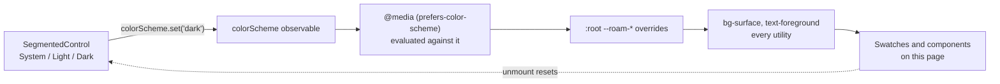

# 05 . Design system preview page

Status: done

## Goal

A screen that shows the whole design system at once, so a token or a primitive
can be reviewed without hunting through source, and dark mode can be checked
without changing the device setting.

## Decisions

| # | Decision | Choice | Why |
|---|----------|--------|-----|
| 1 | Where it lives | New route `/design-system` | Keeps `src/app/index.tsx` as the smoke test and makes the page reachable by deep link. Confirmed with the user. |
| 2 | How complete | Full reference — 18 tokens, 7 type steps, spacing, radius, shadows, all 14 primitives, 28 glyphs | A partial page would still need the source for the missing half. Confirmed with the user. |
| 3 | Dark mode | System / Light / Dark switch driving `colorScheme` | Dark mode was never verified on a device. Confirmed with the user. |
| 4 | Scheme forcing mechanism | `colorScheme.set()` from `react-native-css` | Verified in the library source: `colorScheme` is the same observable that `@media (prefers-color-scheme)` is tested against, so forcing it exercises the real `:root` overrides rather than a parallel mock. |
| 5 | Cleanup on unmount | `useEffect(() => () => colorScheme.set(null), [])` | The switch is global. Leaving it set would force the rest of the app into the reviewer's chosen scheme after navigating away. |
| 6 | Where the scaffolding lives | `src/components/design-system/` | `AGENTS.md` says keep components out of `src/app/`; the two-screens rule says they do not belong in `ui/` yet because nothing else uses them. |
| 7 | Hex values shown | From `src/theme/colors.ts`, extended with the 5 tints | The swatch **fill** comes from the utility class (proving the CSS var resolved), the text needs a literal. Extending the mirror keeps all 18 tokens displayable and keeps it a true mirror of `:root`. |
| 8 | Tints added to the TS mirror | `lavenderTint`, `successTint`, `errorTint`, `starTint`, `infoTint`, light and dark | The mirror was previously 13 of 18 tokens; only the JS-only subset was present. |
| 9 | Dark hex column | Exports `darkColors` (was module-private) | A reference page that can only show light values cannot show what dark mode does. |

## Diagrams

That is the whole reason the switch works, and the reason it exercises the real
CSS rather than a second set of values.

## Out of scope

| Item | Belongs to |
|------|-------------|
| Screens that use the primitives in anger | the first real feature |
| A route link from the app's navigation | `02-system-design` (there is no tab bar yet) |
| Gating the page out of release builds | later, once there is a release build to gate |
| Motion examples | `--ease-standard` is declared but no motion primitive exists yet |

## Steps

1. Export `darkColors` and add the 5 tint tokens to both halves of
   `src/theme/colors.ts`, so the page can show every token's value.
2. Write `src/components/design-system/preview.tsx` with `Section`, `Frame`,
   `Field`, `Swatch`, `ScaleBar`, `RadiusBox`.
3. Write `src/app/design-system.tsx`: header, scheme switch, then one section
   per token family and per primitive, with local state for the interactive
   examples.
4. Record the page in `AGENTS.md`.

## Verification

| # | Check | Result |
|---|-------|--------|
| 1 | `npx tsc --noEmit` | clean |
| 2 | `npm run lint` | clean |
| 3 | `npx expo-doctor` | 20/20 |
| 4 | Tailwind CLI — every new utility emits, including `last:border-b-0` (`&:last-child`) and the 5 new `bg-*` tints | pass |
| 5 | `expo export --platform ios` — bundle holds `colorScheme`, `prefers-color-scheme`, `Appearance`, every primitive | pass |
| 6 | `expo export --platform web` — CSS holds `--roam-on-primary`, `--roam-lavender-tint`, `--color-on-primary`, the dark block | pass |
| 7 | Page renders and the switch flips the tokens on a device | ❌ needs macOS |

## AGENTS.md updates

Added a Design system bullet recording that the reference page is
`/design-system`, that its scaffolding stays out of `ui/`, and that the
System/Light/Dark switch calls `colorScheme` from `react-native-css` and resets
on unmount so dark-mode review does not leak into the rest of the app.

## Result

Built. `/design-system` renders the 18 color tokens as swatches filled by their
own utility classes, the 7-step type ramp with every tone, the spacing and
radius scales at true size, the 3 shadow levels, all 14 primitives across their
variants, sizes and states, and all 28 icon glyphs.

Verified: type check, lint and doctor clean; every new Tailwind utility emits;
both platform bundles carry the tokens, the primitives and `colorScheme`.

Not verified: the page rendering at all, and the scheme switch flipping the
tokens — both need a device. The `last:border-b-0` on swatch rows compiles to
`&:last-child`, whose runtime support in `react-native-css` was not exercised
here; if the last swatch keeps its bottom border that is the cause, and the fix
is to drop the class rather than fight the selector engine.