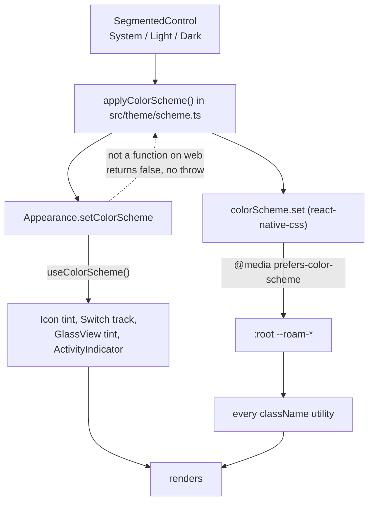

# 06 . Theme switch and capsule polish

Status: done

## Goal

Fix the defects a first run on a device exposed: icons invisible on a light
page, the Light/Dark switch doing nothing, a horizontal tab bar, and several
page-layout clipping bugs.

## Decisions

| # | Decision | Choice | Why |
|---|----------|--------|-----|
| 1 | Root cause | One bug, not many. `Icon`, `Switch`, `GlassView` and `ActivityIndicator` read `useThemeColors()` → `useColorScheme()` (device), while every `className` reads the CSS `:root` variables. Two sources of truth that disagreed. | Confirmed visually: on a light page the Toggle thumb rendered `#17172A` (dark `surface`) and the tab bar border `#2A2A3F` (dark `border`), both light-mode values in JS. |
| 2 | How to force a scheme | Set **both** halves: `Appearance.setColorScheme()` and `colorScheme.set()` from `react-native-css` | react-native-css subscribes to `Appearance.addChangeListener` and feeds it into its own observable, so `Appearance` drives both. Writing both is belt-and-braces for Android, where the change event may not fire. |
| 3 | Reset | Both reset on unmount (`"unspecified"` / `null`) | The override is app-global; leaving it set would force the scheme on the rest of the app after navigating away. |
| 4 | Tab bar layout | Vertical — icon above label, active `bg-primary` wrapping both | `home.png` shows this, not icon-beside-label. |
| 5 | Category glyphs | Cabins → `tree.fill`/`park`, Beach → `water.waves`/`waves`; City and Villas unchanged | The design uses a pine tree and a wave. Verified both exist in SF Symbols and in expo-symbols' Material set. |
| 6 | Villas glyph | Keep `house.lodge`/`villa` | No palm glyph exists in either symbol set. Chosen by the user. |
| 7 | Capsule centring | `justify-center` plus `leading-none` on the label in `Chip`, `Badge`, `StatusAlert` | The caption ramp is 14px at a 1.5 ratio, so a 21px line box drifts off-centre against a 16px icon. **Applied on the user's instruction to use my best guess — the screenshots did not actually show bad centring, so this is the least-verified change here.** |
| 8 | Page layout | Icon cells `w-16` → `w-20` with `numberOfLines={2}`; `items-center` on the chip row; `Field` hint wraps; swatch stacks its hex values in one column | Each of these was visibly wrong in the screenshots: mid-word label wraps, an offset `sm` chip, a clipped hint, and `--color-gla ss` breaking mid-token. |
| 9 | Loading spinner | Left alone | The screenshots showed a dot, which is plausibly one animation frame. Unconfirmed, so not changed. |

## Diagrams

Both arrows must be written on every change. The original bug was writing only
the lower one. The `return false` branch is web: react-native-web has no
`Appearance.setColorScheme`, and react-native-css's web `set()` calls that same
missing method.

## Out of scope

| Item | Why |
|------|-----|
| Geometric Sans font files | Needs the assets from the user; still rendering in the platform sans |
| Gating `/design-system` out of release builds | No release build yet |
| Dark-mode values themselves | Derived, not from the design — unchanged here |

## Steps

1. `src/app/design-system.tsx` — import `Appearance`, set both halves in
   `apply()`, reset both in the unmount effect.
2. `src/components/ui/icon.tsx` — swap the cabin and beach glyphs.
3. `src/components/ui/tab-bar.tsx` — `flex-row` → `flex-col` on each item.
4. `src/components/ui/chip.tsx`, `badge.tsx`, `status-alert.tsx` —
   `justify-center`, `leading-none`, and strip trailing whitespace.
5. `src/app/design-system.tsx`, `src/components/design-system/preview.tsx` —
   the four page-layout fixes above.
6. Record the two half-theme rule in `AGENTS.md`.

## Verification

| # | Check | Result |
|---|-------|--------|
| 1 | `npx tsc --noEmit` | clean |
| 2 | `npm run lint` | clean |
| 3 | `npx expo-doctor` | 20/20 |
| 4 | Tailwind CLI — `leading-none` emits `line-height: 1`, `shrink`, `w-20`, `flex-col` all present | pass |
| 5 | `expo export --platform ios` — bundle carries `setColorScheme`, `unspecified`, `water.waves`, `tree.fill`, `park`, `waves`, `leading-none` | pass |
| 6 | Icons visible in light mode | ❌ needs a device |
| 7 | Light/Dark switch flips both halves | ❌ needs a device |
| 8 | Dark mode has never been seen rendering | ❌ needs a device |

## AGENTS.md updates

Added the two-half theme rule (`Appearance.setColorScheme` **and**
`colorScheme.set`, set and reset together), extended the line-height rule to
capsules needing `leading-none`, noted that the `/design-system` switch writes
both halves, and recorded the category glyph choices.

## Result

Built. The theme switch now writes both halves through `applyColorScheme()`,
which is the fix behind every "icon is invisible" report; the tab bar is
vertical per the design; Cabins and Beach use the designed glyphs; chips,
badges and alerts centre their content; and the four page-layout clipping bugs
are gone.

**Web crash fixed, native still undiagnosed.** `applyColorScheme()` feature-
detects `Appearance.setColorScheme` and returns `false` where it is missing
rather than throwing, which resolves the `Appearance.default.setColorScheme is
not a function` crash. The switch doing nothing on the phone is **not** fixed
and is not claimed to be: a temporary `Diagnostics` panel is now mounted at the
top of `/design-system` and reports each layer separately, because two fixes
have now been applied and neither was verified on a device. Read that panel
before changing anything else.

Verified at compile and bundle level only: type check, lint, doctor 20/20, both
platform exports. Nothing visual has been checked — **dark mode has still never
been seen rendering**, and the capsule centring change remains a hypothesis.