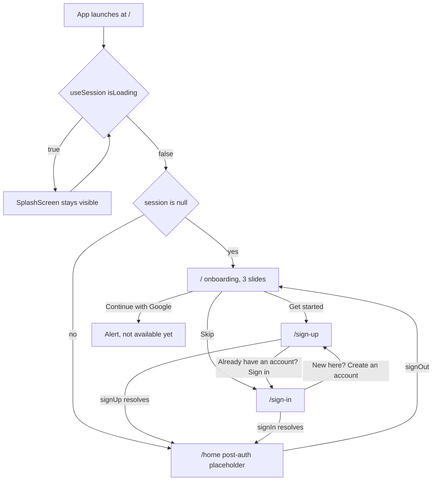

# 07 . Onboarding and auth entry

Status: done

## Goal
A user launches the app, swipes three onboarding slides matching `onboarding.png`, and can reach a working sign-up or sign-in. Credentials land in a local mock session, and the root layout guards routes on it, so the app has a real navigation shape to swap Clerk into later.

## Decisions

Chosen by the user:

| # | Decision | Choice | Why |
|---|----------|--------|-----|
| 1 | Auth backend | Mock session, no Clerk this pass | Keeps the app runnable with no keys. The seam is `useSession()`, so Clerk slots in behind the same interface. |
| 2 | Onboarding slides | Three, flat array in `src/data/onboarding-slides.ts` | Slide 1 carries the design's exact copy; slides 2–3 get other Unsplash photos and copy written to match. |
| 3 | Skip target | `/sign-in` | Skipping onboarding reads as "I already know this app", so returning users land on sign-in rather than sign-up. |
| 4 | Social buttons | Render, press shows an `Alert` saying it is not available yet | Matches the design visually without pretending to work. |
| 5 | Brand marks | Add `react-native-svg`, ship `assets/brand/google-g.svg` | Emoji iconography is banned by AGENTS.md and no brand assets exist in `assets/`. Apple mark deferred with OAuth. |
| 6 | Auth screen scope | Minimal placeholders: back button, wordmark, heading, email + password, CTA, cross-link | Deliberately does not build the labelled fields, or-divider, or social buttons from `auth.png`. |

Defaults picked:

| # | Decision | Choice | Why |
|---|----------|--------|-----|
| 7 | Session shape | `SessionProvider` + `useSession()` in `src/auth/`, in-memory only | Mirrors the Expo Router auth guide. No persistence, so every reload returns to onboarding — honest for a mock. |
| 8 | Paging | `FlatList` `pagingEnabled` + `onMomentumScrollEnd` | Native paging feel with no Reanimated wiring. A Reanimated crossfade is an easy later upgrade. |
| 9 | Location chip | Screen-local `View`, not promoted to `Chip` | One user. `Chip` has no scrim variant, and adding one would drag in a new tone anyway. |
| 10 | Route layout | `/` = onboarding, `/home` = post-auth placeholder | `/` must be the signed-out anchor. A `(app)/index.tsx` would collide with it on `/`. |
| 11 | Header | `headerShown: false` per-screen, not global | `/design-system` relies on its default header. |
| 12 | Splash | `expo-router` `SplashScreen` + controller; `app.json` colour to `#0B0B1A` | The stock `#208AEF` Expo blue flashing before a brand-yellow onboarding is jarring. |

### Proposed tokens

Nothing new is hardcoded in a screen. Four values in the design have no token today:

| Token | Value | Reaches | Why new | Source |
|-------|-------|---------|---------|--------|
| `--color-scrim` / `--roam-scrim` | `rgba(11, 11, 26, 0.55)` | `bg-scrim` | The "Whistler, BC" pill. `--roam-glass` is white-only. | estimated from the mockup |
| `--color-on-scrim` / `--roam-on-scrim` | `#ffffff` | `text-on-scrim`, `Icon tone` | White pin and label on that pill. Fixed in both schemes, like `on-primary`. | design |
| `--radius-sheet` | `32px` | `rounded-sheet` | The bottom sheet's top corners. Nothing above `rounded-card` (16px) exists. | estimated from the mockup |
| `--text-hero` | `40px`, line-height `1.1` | `text-hero` | The onboarding headline and auth heading both measure ~38–40px. The ramp jumps 28 → 56 with nothing between, and 56 is the wordmark. | estimated from the mockup |

## Diagrams

`Stack.Protected` in the root layout is what makes this hold: the signed-out guard mounts `index`, `sign-in`, `sign-up`; the signed-in guard mounts `(app)`. Changing `session` remounts the stack, so the user lands on the other side automatically. A deep link to `/sign-in` while signed in finds that route removed from the stack and redirects.

The second place the mock session shows is the splash: `useAuth`-style loading is asynchronous, so `SplashScreenController` holds the splash until `isLoading` is false.

## Out of scope

| Item | Belongs to / why |
|------|------------------|
| `@clerk/clerk-expo`, publishable key, `.env` | Later plan, behind the `useSession()` seam. AGENTS.md already names Clerk as the auth source of truth. |
| Email verification code step | Same — it exists because Clerk emails the code. |
| Google / Apple OAuth | Later plan. Buttons render and announce themselves. |
| Apple brand mark | Same. |
| Full `auth.png` screens — labelled fields, or-divider, social buttons | User chose minimal auth placeholders. |
| Persisting the mock session | In-memory only; needs `expo-secure-store` or similar. |
| An "onboarding seen" flag | The `Stack.Protected` guard covers it — signed-out users always see onboarding. |
| Reanimated slide crossfade | `FlatList` paging is enough for now. |
| Showing the new tokens on `/design-system` | The reference page is left untouched; it picks the new tokens up in a later pass. |
| `expo-linear-gradient` scrim behind the sheet | `shadows.overlay` is enough. |

## Steps

### 1. Plan file
Write `prompts/07-onboarding-and-auth-entry.md`.

### 2. Tokens
Add the four proposed tokens to `src/global.css` (`@theme` map + `:root`), `src/theme/colors.ts`
(`ThemeColors`, `lightColors`, `darkColors`), and `src/theme/variables.ts` (`--roam-*`). Add an
`onScrim` tone to `TextTone` in `src/components/ui/themed-text.tsx`. Done when `/design-system`
still renders and the new utilities resolve.

### 3. Primitives
`Button` gains an optional `className` appended last — which AGENTS.md already claims every
primitive has, but `Button` did not — and a `leading?: ReactNode` slot rendered before the label,
because brand marks are not SF Symbols. `Icon` gains `chevronLeft`.

### 4. Brand mark
`npx expo install react-native-svg`, add `assets/brand/google-g.svg`, and render it from
`src/components/brand/google-mark.tsx`. Done when the Google button shows the multicolor G.

### 5. Session
`src/auth/session.tsx`: `SessionProvider`, `useSession()`, and a mock `signIn`/`signUp` that require
an email and a password of at least 8 characters, resolve after a short delay, and keep the session
in React state only. `signOut` clears it.

### 6. Routing
Rewrite `src/app/_layout.tsx` as `ThemeProvider > SessionProvider > SplashScreenController +
RootNavigator`, with the two `Stack.Protected` blocks and `contentStyle` carrying the themed
background. Add `src/app/(app)/_layout.tsx` and `src/app/(app)/home.tsx`.

### 7. Onboarding
Replace `src/app/index.tsx` with the carousel: full-bleed `expo-image` per slide, a top bar holding
`Wordmark` and the glass `Skip` button, the location pill, `PageDots`, and the sheet carrying the
hero heading, the muted body, `Get started`, and `Continue with Google`.

### 8. Auth screens
Add minimal `src/app/sign-up.tsx` and `src/app/sign-in.tsx`, both wired to the mock session and
cross-linked.

### 9. Config
Splash background colour in `app.json`.

### 10. Verification
Lint, type check, bundle check, and the guard round trip.

## Verification

| # | Check | Result |
|---|-------|--------|
| 1 | `npx tsc --noEmit` | ✅ |
| 2 | `npx expo lint` | ✅ |
| 3 | Routes bundle with no duplicate-route error on `/` | ✅ |
| 4 | Unsplash URLs return `200 image/jpeg` | ✅ checked while planning |
| 5 | Screenshot compared against `onboarding.png` | ❌ needs macOS — `xcrun simctl` does not exist on this Windows host |
| 6 | Signed-out → signed-in → signed-out round trip | ❌ needs a running simulator or device |
| 7 | Design values measured rather than estimated | Partial — `--color-scrim`, `--radius-sheet`, and `--text-hero` are estimates from the mockup, listed above. No device screenshot to check them against. |

The two ❌ checks are honest gaps, not skips: AGENTS.md asks for an iOS simulator screenshot loop and
this host is Windows, so that loop cannot run here.

## AGENTS.md updates
- Design system: the four new tokens, and the `Button` `className`/`leading` additions.
- Routing: `/` is onboarding, `/home` is the post-auth placeholder, and `Stack.Protected` guards on
  `useSession()`.
- Rules: Clerk is deferred behind the `useSession()` seam, so a later session does not treat the mock
  as the auth source of truth.

## Result
Built. A cold start now lands on a three-slide onboarding carousel matching `onboarding.png` — full-bleed Unsplash photo, `roam` wordmark, glass Skip pill, scrim location pill, `rounded-t-sheet` sheet with the lavender page indicator, hero headline, yellow `Get started`, and a `Continue with Google` button carrying the real four-colour Google mark. Get started reaches `/sign-up`, Skip reaches `/sign-in`, and both post a mock session that flips the `Stack.Protected` guard to `(app)/home`.

Twelve files touched. Tokens: four new values in `global.css`, `colors.ts`, and `variables.ts`, plus an `onScrim` tone on `ThemedText` and a `hero` variant. Primitives: `Button` gained `className` and a `leading` slot, `IconButton` gained `className`, `Icon` gained `chevronLeft`. New: `src/auth/session.tsx`, `src/components/brand/google-mark.tsx`, `src/components/onboarding/page-dots.tsx`, `src/components/auth/auth-shell.tsx`, `src/data/onboarding-slides.ts`, `src/app/sign-in.tsx`, `src/app/sign-up.tsx`, `src/app/(app)/_layout.tsx`, `src/app/(app)/home.tsx`. `src/app/_layout.tsx` was rewritten around the guards and a splash controller; `src/app/index.tsx` is now onboarding; `app.json` lost the stock `#208AEF` splash for `#0B0B1A`.

### A follow-up pass, after the first run on a device

Two motion defects only showed up once it was actually swiped, and both are fixed.

**The photo flashed while sliding.** Three causes stacked. Each `Image` had `transition={250}`, which on a full-bleed background is indistinguishable from a flash. Nothing was prefetched, so a swipe could land on a page whose photo had not arrived and the light app background showed through. And nothing covered the gap while it loaded. Fixed by dropping the transition, prefetching all three photos on mount (`Image.prefetch`, with a failure that never blocks the carousel), holding `scrollEnabled` until they land, giving the pager a `bg-scrim` backdrop so the sliver between pages is never white, and attaching a **blurhash encoded from each actual photo** as the placeholder — synchronous, so it covers the download with something that is already the right colours instead of a grey box.

**The layout changed with the slide.** The sheet sized itself to whichever slide was showing, and because the photo above it is `flex: 1` with `contentFit="cover"`, a few points of sheet height re-cropped the image — the horizon moved on every swipe. A hardcoded `minHeight` only moved the knife-edge, it did not remove it. Replaced with `useSteadyHeight` (`src/components/onboarding/use-steady-height.ts`): every slide's copy is rendered off-screen and absolutely positioned inside the sheet, each reports its height, and the visible block is pinned to the tallest of them. It stays a floor rather than a cap, so Dynamic Type still grows the sheet rather than clipping it.

### A second follow-up: the proportions were wrong

A device screenshot showed the sheet eating ~64% of the screen and the buttons reading as oversized. The plan had guessed those values off the mockup by eye, and the guesses were too big.

Rather than eyeball again, the design PNG was measured programmatically. Its screen bounds are recoverable exactly — the yellow CTA gives horizontal references, the bezel gives the top edge, and the sheet is the only large pure-white block. Scale is `393 / 628 = 0.6258` pt/px, which made these reliable:

| | design | was | now |
|---|---|---|---|
| CTA height | 50–51pt | 68.4pt (`size="lg"`) | 52.4pt (`size="md"`) |
| Google button | 50.1pt | 68.4pt | 52.4pt |
| CTA width | 344pt | 345pt | unchanged |
| sheet left margin | 24.4pt | 24pt | unchanged |
| page dots height | ~8pt | 8pt | unchanged |
| body font | 16pt | 16pt | unchanged |
| body line box | ~20pt (ratio 1.25) | 24pt (1.5) | 20.8pt (1.3) |
| heading font | ~30pt | 40pt | 32pt |
| heading line box | ~38pt (ratio 1.19) | 44pt (1.1) | 38.4pt (1.2) |

`size="md"` rather than a new button size: the design's 50pt sits 2pt off `md`'s 52.4pt and 18pt off `lg`'s 68.4pt, and the horizontal padding `md` already carries is what the design shows. The sheet then lands at ~41% of the screen against the design's 41%, so the photo gets its 59% back without any hardcoded height — the composition falls out of the tokens.

The sheet's `gap-lg` between copy and buttons also went to `gap-md`. Two `24pt` gaps in a short column compound, and 16 is what the gap actually measures.

One measurement resisted: the design's page dots have an active segment visibly wider than the inactive ones, and 40pt is not on the spacing scale. Uniform 32pt segments stay, because inventing a token for a 8pt difference is worse than the difference.

### Other deviations from the plan

`assets/brand/google-g.svg` was **not** shipped. Reading an `.svg` at build time needs `react-native-svg-transformer`, which needs a `babel.config.js` this project deliberately does not have; adding one next to `experiments.reactCompiler` and the NativeWind Metro chain is more risk than one logo is worth. The path data is inlined in `GoogleMark` instead, with a comment saying why.

`npx expo install react-native-svg` failed. This npm rejects the `--allow-scripts` flag that `expo install` passes on a project-scoped install. The dependency landed in `package.json` correctly, so the fix was running `npm install` directly — now recorded in AGENTS.md's Commands.

`isLoading` starts `false` rather than being set by an effect. `react-hooks/set-state-in-effect` correctly flagged the effect version as a cascading render for nothing, since there is no async read to perform yet. Clerk's arrival is what makes the read real.

Not verified, and it matters: **no visual diff against the design was done on this host.** `xcrun simctl` does not exist on Windows, so the screenshot loop AGENTS.md requires could not run. A screenshot from the user's own device is what exposed the proportion errors, and it is the only way to confirm the corrections. Lint, types, and a full Android production bundle pass, and the route tree resolves to `/`, `/sign-in`, `/sign-up`, `/home`, `/design-system` with no `/` collision.

The reverse-engineered type sizes carry real uncertainty. Inking out the headline's width per line gave three mutually inconsistent answers (24pt, 33pt, 37pt) because the mockup's letterforms are not a real typeface, so the 32pt `hero` is a judgement call that sits inside the range rather than a measurement. Everything geometric — button heights, margins, dot height, sheet proportion — came from clean edge detection and should hold.

