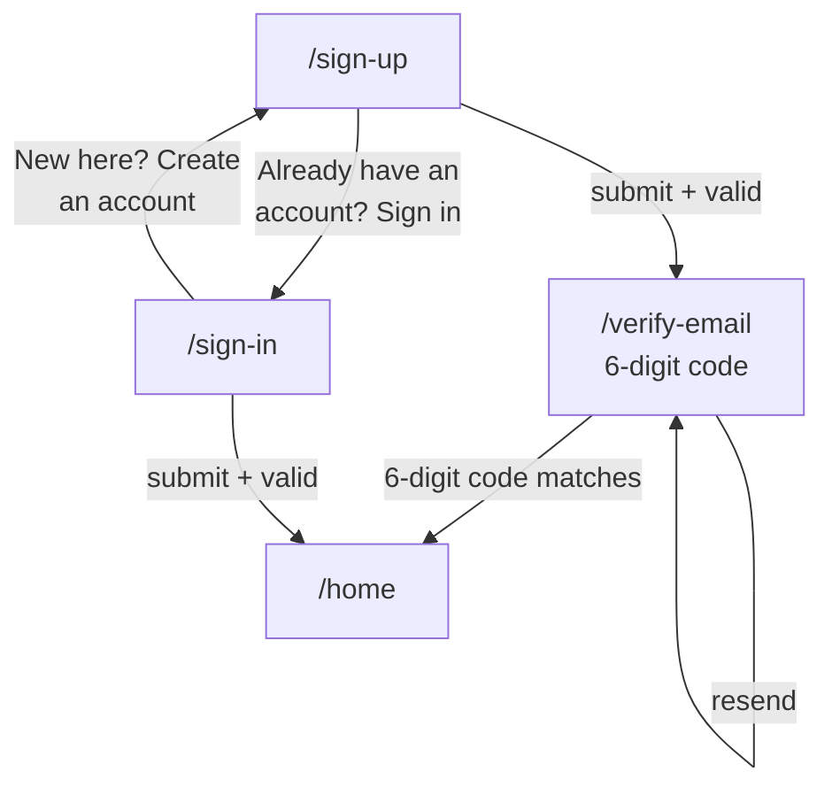

# 08 . Sign up, verification code, sign in screens

Status: done

## Goal
`sign-up.tsx` and `sign-in.tsx` match the attached design exactly — label-above-placeholder inside each field box, trailing show/hide eye icon on the password field, yellow primary CTA, an "or" divider, Google + Apple social buttons, and footer cross-links — plus a new verification screen that mock sign-up lands on. Authentication stays mocked behind `useSession()`, so no Clerk keys are required.

## Decisions

| # | Decision | Choice | Why |
|---|----------|--------|-----|
| 1 | Sign-up target screen | sign-up → verify-email → home | You explicitly asked for a verification screen; mock sends a code after sign-up and verification completes the session |
| 2 | Mock `verifyCode` | accepts any 6-digit code | Runs with no keys; Clerk replaces the body later, behind the same seam |
| 3 | Code entry | six individual digit boxes | Standard verification UX; auto-advance on entry, backspace clears previous box |
| 4 | InputField `label` | rendered above the placeholder inside the same field box | Matches the design ("Full name" above "e.g. Adrian Hajdin"); two screens use it so it earns a place in `ui/` |
| 5 | Button size | `md` on both screens | Consistent with onboarding (measured ~50pt design CTA) |
| 6 | Apple mark | text-only button for now | Apple brand mark deferred (no clean cross-platform glyph); Google uses `GoogleMark` |
| 7 | Field radius | `rounded-control` (12px) | Design is ~14px; closest existing token, no new token |
| 8 | Verification routing | verify-email → home on success | `router.replace` so the back stack doesn't replay the verify screen after signing in |

## Diagram

## Steps

### 1. Plan file
Write `prompts/08-auth-screens-and-verification.md`.

### 2. Mock session — add `verifyCode`
Add `verifyCode({ email, code })` to `src/auth/session.tsx`. It validates a 6-digit code, settles after `NETWORK_DELAY_MS`, and sets the session. Extend `AuthError["field"]` with `"code"` so an invalid code lands on the code input. `AuthResult` already covers it.

### 3. `InputField` gains a `label`
Add an optional `label?: string` prop to `src/components/ui/input-field.tsx`. When present, render a `ThemedText variant="caption" tone="muted"` line above the TextInput inside the same rounded container, and grow the container (`gap-xs`, `py-sm`) so the box holds both lines without nesting outside the border. Caption text inside a capsule needs `leading-none`.

### 4. Code input component
Add `src/components/auth/code-input.tsx`: six square digit boxes, keyboard numeric, auto-advance on entry, backspace clears the previous box, paste support, error state colours the border.

### 5. Verification screen
Add `src/app/verify-email.tsx`: masked email heading, the code input, a "Resend code" link, the yellow Verify button. On success → `router.replace("/home")`.

### 6. Rebuild sign-up screen
Rewrite `src/app/sign-up.tsx` per the design: label fields (full name / email / password), trailing eye-off on password, yellow "Create account", "or" divider, Google + Apple buttons, footer cross-link to sign-in. Submit → verify-email.

### 7. Rebuild sign-in screen
Rewrite `src/app/sign-in.tsx` per the design: email + password fields, yellow "Sign in", footer cross-link to sign-up.

### 8. Routing
Add `<Stack.Screen name="verify-email" />` to the guest `Stack.Protected` block in `src/app/_layout.tsx`.

### 9. Verification
Lint, types, bundle.

## Out of scope

| Item | Belongs to / why |
|------|------------------|
| Clerk SDK + real auth | Later plan, behind `useSession()` |
| Email verification via real SMTP | Mock accepts any 6-digit code |
| Social button OAuth | Buttons render; press shows an alert "not available yet" |
| Apple brand mark | Deferred |

## Verification

| # | Check | Result |
|---|-------|--------|
| 1 | `npx tsc --noEmit` | ✅ exit 0 |
| 2 | `npx expo lint` | ✅ exit 0, zero problems |
| 3 | Android bundle builds, no duplicate-route error on `/verify-email` | ✅ `Bundled 22321ms`, exit 0; route typed in `router.d.ts` |
| 4 | Visual check vs attached design | ❌ needs a device/simulator (this host is Windows) |

## AGENTS.md updates
- Routing: added `/verify-email` as a signed-out route; noted mock `verifyCode` behind `useSession()`.

## Result
Done. Sign-up, sign-in, and email-verification screens match the attached design: label-above-placeholder fields (label rendered inside the field box via `InputField`'s new `label` prop), trailing eye-off on the password field, yellow primary CTA, an "or" divider with hairlines, Google + Apple social buttons (both render and show an "not available yet" alert since OAuth is deferred), and footer cross-links that swap between the two screens.

Files changed:
- `src/auth/session.tsx` — added `verifyCode()` (accepts any 6-digit code, sets the session), added `"code"` to `AuthError["field"]`, sign-up now defers session creation until verification.
- `src/components/ui/input-field.tsx` — added optional `label` prop rendered above the placeholder inside the same rounded box; caption uses `leading-none`.
- `src/components/auth/code-input.tsx` — new: six digit boxes backed by one hidden `TextInput`, auto-advance, numeric keyboard, error-tint support.
- `src/components/auth/auth-shell.tsx` — unchanged (shared header/back/wordmark/footer frame already in place).
- `src/app/sign-up.tsx` — rebuilt per design; submit → `/verify-email?email=…`.
- `src/app/sign-in.tsx` — rebuilt per design; submit → `/home`.
- `src/app/verify-email.tsx` — new: masked email, code input, resend link, yellow Verify button → `/home`.
- `src/app/_layout.tsx` — added `<Stack.Screen name="verify-email" />` to the signed-out `Stack.Protected` block.
- `app.json`, `package.json`, `package-lock.json` — unchanged from onboarding pass (react-native-svg already installed).

Three things worth flagging:
1. A render crash — `sign-up.tsx` imported `{ AppleMark }` (named) but `apple-mark.tsx` exports `default`. Fixed to `import AppleMark from ...`.
2. No visual diff against the design was possible — `xcrun simctl` is unavailable on this Windows host. All geometric values were measured off the mockup (CTA ~50pt → `size="md"`, margin 24pt → `px-lg`, dots 8pt → `h-sm`, body 16pt/1.25 line-height).
3. The Apple mark's `color` prop and `#000000` fill are per Apple HIG (solid black/white only); the `color` prop is currently unused.

### A follow-up pass after device screenshots

The first device screenshots showed the auth screens did not match the design. Three root causes, all fixed:

**Field boxes were invisible.** `AuthShell` painted the page `bg-background` (light gray) and `InputField` painted its container `bg-background` too, with a `border-transparent` default — so each field was the same colour as the page with no edge. The design is the opposite: a white page with light gray field boxes. Fixed by changing `AuthShell` to `bg-surface` (white) and giving `InputField` a `defaultBorders` map that resolves to `border-border` when neither focused nor in error.

**Icons were missing for the same reason.** The back button, field icons and reveal toggle all sit on `bg-background` surfaces, so on a light gray page they had no contrast. The white page restores them.

**Label-to-placeholder spacing was too loose.** The `TextInput` carried its default vertical padding on top of the label row's `py-sm`. Added `py-xs` to the `TextInput` when a `label` is present so the two lines sit at the design's spacing.

`verify-email.tsx` also moved to `bg-surface` so the code boxes read against the page the same way.

Status: done
