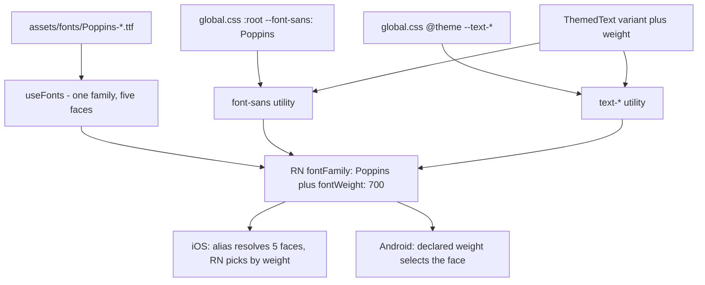

# 09 . Typography: Poppins + the design.png §03 ramp

Status: approved

## Goal

Every piece of text in the app renders in the design's geometric sans (Poppins)
instead of the platform font, and the type ramp matches `design.png` §03
(Display 56–64/1.0 Bold, Heading 28–32/1.2 Bold, Body 16/1.5 Regular,
Caption 14 Medium, Button 17–18 Medium) with no component left holding a
hardcoded text size.

## Decisions

Answered by the user:

| # | Question | Answer | Why |
|---|----------|--------|-----|
| 1 | Which typeface? | **Poppins** | Zooming `design.png` §03 shows a single-storey `a` (circle + stem), circular bowls, a straight-tailed `y` and a splayed `M` — a true geometric sans. Plus Jakarta Sans has a double-storey `a` and would not match. |
| 2 | How do the files reach the repo? | **Vendor the TTFs into `assets/fonts/`** | No new dependency (AGENTS.md asks first), and it matches the rule that fonts come from `assets/`. Five cuts ≈ 780 KB. |
| 3 | Runtime load or config plugin? | **Runtime `useFonts`** | expo-font SDK 58 aliases one family name to several faces on iOS (swizzled `UIFont.fontNames(forFamilyName:)`) and selects by declared weight on Android, so `fontFamily` + `fontWeight` picks a real face on both. The plugin takes the family name from the file, and Poppins Medium is a separate iOS family. |
| 4 | Ramp scope? | **Keep the 7 steps, fix the weights** | The sheet defines five steps; `hero` and `title` are app-specific and were confirmed in `prompts/04-design-system.md:52`. Only the weights and the ad-hoc utilities change. |

Defaults picked by me (say the word and I will change them):

| # | Decision | Choice | Why |
|---|----------|--------|-----|
| 5 | Which cuts to ship | 400, 500, 600, 700, 800 | 400 body, 500 caption/button, 700 display/heading/title, 800 hero/wordmark, 600 the sign-in link. Shipping 600 avoids a visual change nobody asked for. |
| 6 | How the family reaches text | `font-sans` on every text element | React Native has no font inheritance, so the family has to be set per element. `ThemedText` carries it; the `TextInput`s get it explicitly. |
| 7 | Wordmark weight handling | New `weight` prop on `ThemedText` | The cascade follows compiled CSS order, not class order, so two weight utilities in one class list resolve by whichever Tailwind emits last. A separate slot removes the conflict. |
| 8 | Code-input digit size | `variant="title"` (18px, Bold) | `text-lg` compiles to 15.75px on native (react-native-css inlines `rem` against a 14px base) and 18px on web. `title` is a ramp token at 18px. |
| 9 | Navigation header | Leave the platform font, note it | The `/design-system` header is the only native header left. `headerTitleStyle` would fix it, but it is outside the ramp. |
| 10 | Pre-existing type errors | Fix the ones in touched files | `tsc --noEmit` failed with 8 errors (RN 0.88 ref types, an invalid `Icon` prop, an invalid `ThemedText` tone, `scheme.ts` nullability). AGENTS.md requires a clean type check, so the ones in the files this change touches get fixed. |
| 11 | Docs folders in the Tailwind scan | Excluded | Tailwind scans markdown, so a class name written in a plan generated CSS for a utility nothing renders — and a class that exists only in prose looks applied when the stylesheet says it is. |
| 12 | `AssetRegistry` | A wrapper module, `src/native.ts` | Found on device: `react-native-css`'s barrel misses one React Native export, and `expo-asset` needs it to resolve a bundled asset. See step 7. |

## Diagrams



## Out of scope

| Item | Belongs to / why |
|------|------------------|
| The wordmark as the brand vector asset | The sheet's `roam` is a drawn logotype. Poppins gets us close, not identical. |
| Native navigation header font | Only `/design-system` has one; `headerTitleStyle` is a separate change. |
| A Poppins italic cut | The sheet has no italic. |

## Steps

### 1. Vendor the font files

The five Poppins cuts (SIL OFL 1.1) into `assets/fonts/`, plus the licence
text (`assets/fonts/OFL.txt` — the OFL requires the licence to travel with the
font). Source: `https://github.com/google/fonts/tree/main/ofl/poppins`.

### 2. Load the family in the root layout

`src/app/_layout.tsx` loads the family before anything renders and keeps the
splash up until the fonts are ready:

```tsx
const POPPINS = [
  {
    fontFamily: "Poppins",
    fontDefinitions: [
      { path: require("../../assets/fonts/Poppins-Regular.ttf"), weight: 400 },
      { path: require("../../assets/fonts/Poppins-Medium.ttf"), weight: 500 },
      { path: require("../../assets/fonts/Poppins-SemiBold.ttf"), weight: 600 },
      { path: require("../../assets/fonts/Poppins-Bold.ttf"), weight: 700 },
      { path: require("../../assets/fonts/Poppins-ExtraBold.ttf"), weight: 800 },
    ],
  },
];
```

`RootLayout` returns `null` until `fontsLoaded` (or an error), and passes
`fontsReady` to `SplashScreenController`.

### 3. Point `--font-sans` at Poppins

`src/global.css` — a plain `:root` block placed **after**
`@import "nativewind/theme"`. Verified against the compiled stylesheet: the
root-variable list puts this value at index 0, ahead of nativewind's platform
entries, so it wins on iOS, Android and web.

### 4. Make the ramp explicit in `ThemedText`

`src/components/ui/themed-text.tsx` — size, weight and tracking as separate
slots, a `weight` prop that replaces the variant's weight, and `font-sans` on
every text element. `button` reverts to `font-medium` (the sheet says Medium;
the working tree had drifted to semibold).

### 5. Fix the wordmark

`src/components/ui/wordmark.tsx` — the sizes map carries the ramp step and the
weight instead of a bare size class, so nothing depends on Tailwind's
alphabetical utility order.

### 6. Remove the ad-hoc text utilities

| File | Now | Becomes |
|------|-----|---------|
| `src/app/index.tsx` | `<Text className="text-white text-xs font-medium">` | `<ThemedText variant="caption" tone="onScrim">` — `text-xs` compiled to 10.5px on native (12px on web) |
| `src/components/auth/code-input.tsx` | `font-semibold text-lg` | `variant="title"` — `text-lg` compiled to 15.75px on native (18px on web) |
| `src/components/ui/input-field.tsx` | `font-medium text-[14px] leading-tight` | `leading-tight` only — the `caption` variant is already 14px Medium |
| `src/components/ui/input-field.tsx` | `text-[15px] … leading-snug` | `font-sans text-foreground text-field p-0 m-0` — `--text-field` carries a size and no line height, so iOS cannot wrap and clip the single-line field |
| `src/components/auth/code-input.tsx` | hidden `TextInput` | add `font-sans` |
| `src/components/ui/tab-bar.tsx` | `font-medium` | removed — the `caption` variant is already Medium, so the class was a no-op |

### 7. Give `expo-asset` its `AssetRegistry` back

Found on device: the fonts failed to load with "Cannot read property
'getAssetByID' of undefined".

`react-native-css` re-exports React Native by hand so its components can take
a `className`, and its metro resolver points **every** `react-native` import —
including the ones inside `node_modules` — at that barrel. The hand-written
list covers 95 of React Native's 96 public exports; the one it misses is
`AssetRegistry`, which `expo-asset` needs to resolve a bundled asset.

`src/native.ts` is the module behind every `react-native` import: the barrel
plus that one export. `metro.config.js` points the resolver at it, and keeps
the real React Native for the wrapper's own import and for
`react-native-css`'s own files, so neither cycles.

### 8. Clear the pre-existing type errors in the touched files

`tsc --noEmit` failed with 8 errors before this change: an invalid `Icon`
prop, a duplicated `@/theme` import (the only two lint warnings), an invalid
`ThemedText` tone, the RN 0.88 `TextInput` ref type in two files, and
`scheme.ts` nullability. All are fixed.

### 9. Synchronise the documentation

`AGENTS.md` (ramp, font, the `--font-sans` rule, the `react-native` wrapper,
the dev-server command), `prompts/04-design-system.md` (typography table, the
font row, the out-of-scope row) and the stale comments in `chip.tsx`,
`badge.tsx`, `status-alert.tsx` and `design-system.tsx`.

## Verification

| # | Check | Result |
|---|-------|--------|
| 1 | `npx tsc --noEmit` | ✅ clean (was 8 errors) |
| 2 | `npx expo lint` | ✅ clean (was 2 warnings) |
| 3 | Compiled stylesheet: `.font-sans` resolves to `var(--font-sans)`; the root-variable list has `"Poppins"` at index 0; `text-field` is `fontSize: 16` with no line height; the ramp sizes and line heights match the sheet; `text-[14px]`, `text-[15px]`, `text-lg`, `text-xs` are gone; 146 rules, down from 171 | ✅ |
| 4 | Web export: `:root{--font-sans:"Poppins"}` in the CSS, `.font-sans{font-family:var(--font-sans)}`, all five TTFs in the asset list | ✅ |
| 5 | iOS export: the five Poppins TTFs in the asset list, `Poppins` and `font-sans` in the bundle, no `text-[14px]` | ✅ |
| 6 | The bundle registers the fonts with React Native's asset registry | ✅ `registerAsset({name: "Poppins-Regular", type: "ttf", …})` |
| 7 | `expo-asset` resolves the real `AssetRegistry` (the wrapper, not the barrel) | ✅ verified in the dev bundle's module graph |
| 8 | Fonts render on a device, weights are real faces | ⏳ pending the user's device check |
| 9 | Screenshot against `design.png` §01/§03 and `onboarding.png` | ❌ no iOS simulator on this machine |

## AGENTS.md updates

- Design system → the type ramp and the sheet it comes from.
- Design system → one size and one weight per text element, and the new
  `ThemedText` `weight` prop.
- Design system → the font is Poppins, vendored in `assets/fonts/`, loaded at
  runtime with `expo-font` as one family with five faces, and `font-sans` has
  to be on every text element.
- Design system → replaces "Don't redefine `--font-sans`": the app now
  overrides it, and the correct form is a plain `:root` block after the
  nativewind import.
- Design system → the wordmark renders in Poppins and is still a text
  approximation of the brand logotype.
- Design system → `react-native` is wrapped by `src/native.ts`.
- Commands → restart the dev server with `--clear` after a `metro.config.js`
  change.

## Result

To be filled in when the device check comes back.
